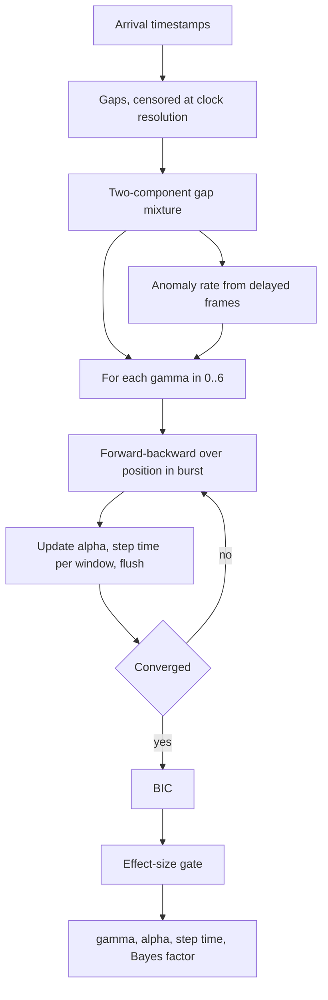
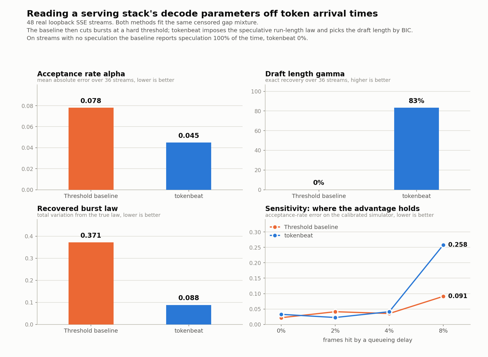

# tokenbeat

Recover a remote LLM serving stack's hidden decode parameters, speculative decoding on or off, draft length, and token acceptance rate, from streaming token arrival times alone.

## The problem

When you call a hosted LLM over a streaming API you are billed per token and you plan capacity against a latency profile, but the thing that produces both is a black box. Whether the provider runs speculative decoding, how long the draft is, how often drafts get accepted, and how loaded the batch is are all invisible from the response body. They are not invisible from the clock.

A server that speculates does not emit tokens one at a time. Each verification step accepts a prefix of its draft and flushes the whole accepted run back to back, so tokens arrive in bursts: several frames microseconds apart, then a full step time of silence. The burst lengths are not arbitrary. Under the standard acceptance model they follow a truncated geometric law whose two parameters are exactly the draft length and the acceptance rate.

So the information is sitting in a timestamp column that every streaming client already has. Reading it back is an inference problem, and the obvious way to do it does not work. Split the gaps at a threshold, cut the stream into bursts, take the longest burst as the draft length and the mean as the acceptance rate, and a single burst merged by one queueing delay ruins the answer: the longest burst is a maximum over a hundred of them.

## What it does

`tokenbeat` takes a list of token arrival timestamps and returns:

- whether the server is speculating, with a Bayes factor rather than a threshold you have to pick
- the draft length `gamma`
- the per-token acceptance rate `alpha`, and the tokens per target forward pass it implies
- the verification step time, per window, which moves as batch occupancy moves
- the intra-step flush time, which is a property of the server's SSE writer rather than its model

It works on logs you already have. The package also ships a loopback SSE harness that streams over a real TCP socket so the method can be measured against known ground truth, and a simulator calibrated to that measured channel.

## Why it is interesting

The speculative decoding literature is almost entirely server side: choosing the draft length, picking a drafter, scheduling speculation against batch occupancy. This is the mirror image. It asks what a client can recover about a decoder it does not control, and it turns out the answer is most of the decode configuration.

Three things make the estimator work where the obvious approach fails.

**The burst law is imposed, not inferred after the fact.** The hidden state is a token's position inside its verification step. Because the speculative burst law has survival `P(K >= j) = alpha ** (j - 1)`, that position chain is a truncated geometric run: continue with probability `alpha` while the position is at most `gamma`, restart with probability one at the cap. Fitting that chain by expectation maximisation ties the segmentation back to the parameters, so a pair of bursts merged by a delay cannot simply be reported as one long burst.

**Coalesced frames are censored, not small.** When two SSE frames land in one socket read the client stamps them identically and records a gap of zero. Treating those as ordinary samples drags the fast component's log-scale parameters down by several nats, and both Otsu's method and 1D k-means then split off that atom instead of finding the real fast/slow boundary. Every component here uses a left-censored likelihood with a Tobit M-step, which is what makes the unstructured baseline strong enough to be worth comparing against.

**The path artefacts are in the model.** A frame held up in a queue inflates its own gap, and in-order delivery collapses the gap behind it toward zero. That produces merged bursts and phantom bursts respectively, so a burst-opening token is allowed to arrive with a gap drawn from the fast distribution, and every gap carries a contamination component. Both allowances share one weight, set from a robust count of delayed frames before any model is fitted, so it is a plug-in rather than a fitted parameter and BIC stays a fair comparison across draft lengths.

Model selection by BIC over `gamma` in 0 to 6 then does three jobs at once: `gamma = 0` is the no-speculation model scored on the same likelihood, the draft length comes out without a biased order statistic, and the output is a Bayes factor instead of a tuning knob.

## Architecture

FigJam board: https://www.figma.com/board/LJvQPqLNcUYX7dYlcXt9e7

The diagram shows the path from a streaming response to recovered parameters: the client timestamps frames, the gap series is censored at clock resolution, a shared gap mixture seeds both estimators, and the structured fit adds the run-length chain and BIC where the baseline adds a threshold.

Algorithm flow:



## Results



The metric is how accurately each method recovers the hidden decode parameters from timestamps alone. The baseline is the same analysis without the burst law: it fits the identical censored gap mixture, then cuts bursts at the posterior threshold and reads `gamma` off the longest burst and `alpha` off the mean. Everything in the first three panels is measured on 48 real SSE streams over a loopback TCP socket, 36 speculative and 12 not, 300 tokens each, with timestamps taken as the client's own `recv` calls return. No timing is modelled.

| method | alpha MAE | gamma exact | burst law TV | step time MAPE | false positives |
|---|---|---|---|---|---|
| threshold baseline | 0.078 | 0.0 percent | 0.371 | 9.6 percent | 100 percent |
| baseline, robust gamma quantile | 0.078 | 0.0 percent | 0.371 | 9.6 percent | 100 percent |
| baseline, given the true gamma | 0.114 | n/a | 0.216 | 9.6 percent | 0 percent |
| **tokenbeat** | **0.045** | **83.3 percent** | **0.088** | 11.8 percent | **0 percent** |

Acceptance-rate error falls from 0.078 to 0.045, a 1.7x reduction. Draft length goes from never recovered to exactly recovered on 83.3 percent of streams: the baseline's longest-burst estimate is pushed past the search cap on every single trace, because a few merged bursts per 300 tokens are enough. The recovered burst-length law moves from 0.371 to 0.088 total variation from the truth, a 4.2x reduction. On the 12 streams with no speculation at all the baseline reports speculation every time, since a handful of delay-compressed gaps make the gap distribution look bimodal, while tokenbeat reports none.

Two results cut against the method and are worth stating plainly. The baseline handed the true `gamma` gets a **worse** acceptance rate than the baseline estimating it, 0.114 against 0.078: its inflated `gamma` was partly cancelling its inflated mean burst length, so its usable number was two errors offsetting, not an accurate one. And tokenbeat's step-time estimate is slightly worse than the baseline's, 11.8 percent against 9.6 percent, because the compressed-boundary allowance lets some genuine step gaps be explained as fast ones. The acceptance rate and the draft length are the accurate outputs; treat the step time as a trend indicator.

The fourth panel is the sensitivity study, run on the simulator calibrated to the measured channel, sweeping how often a frame is hit by a queueing delay worth about two verification steps. tokenbeat is ahead at 2 percent and roughly level at 0 and 4 percent, and at 8 percent it is clearly worse, 0.258 against 0.091. That is a real limit, not a rough edge. Past roughly one delayed frame in twenty the burst structure is genuinely destroyed, and a model that commits to a structure degrades faster than one that does not: tokenbeat's exact `gamma` recovery falls from 100 percent to 33 percent across that sweep. On a clean path with no delayed frames the simple baseline is also marginally better on `alpha`, 0.022 against 0.033, which is the honest shape of the result. The structured model earns its keep on the paths in between, which is where the real traces sit.

## How to run it

```bash
git clone https://github.com/joelvarun/tokenbeat
cd tokenbeat
pip install -r requirements.txt
```

Read back a stack you control, over a real socket:

```bash
python -m tokenbeat.cli demo --alpha 0.85 --gamma 4 --tokens 300
```

Analyse your own capture. One JSON object per line with a `t` field holding a monotonic arrival time in seconds, which is what you get from stamping `time.perf_counter()` on every SSE frame your client decodes. A plain text file of one float per line also works:

```bash
python -m tokenbeat.cli analyze trace.jsonl --baseline
```

Three hidden stacks read back end to end:

```bash
python examples/demo.py
```

Reproduce the chart. The first command streams 48 real responses over loopback and takes about 90 seconds, then scores both estimators and runs the sweep:

```bash
python scripts/run_benchmark.py --refresh
python scripts/make_chart.py
```

Drop `--refresh` to re-score the 48 captured streams in `results/loopback_traces.npz`, which are committed, so the table above reproduces exactly without opening a socket. With `--refresh` the harness captures fresh streams and the numbers move by a little, because the timings are real. From Python:

```python
from tokenbeat import analyze

report = analyze(arrival_times)       # a sequence of monotonic seconds
print(report.summary())
print(report.gamma, report.alpha, report.tokens_per_step)
```

## Example output

`python -m tokenbeat.cli demo --alpha 0.85 --gamma 4 --tokens 300`, on a stream the analyser sees only as timestamps:

```
streaming 300 tokens over loopback with alpha=0.85 gamma=4 step=12.0 ms

tokens observed          300
speculative decoding     yes  (log10 Bayes factor +294.8)
draft length gamma       4
acceptance rate alpha    0.903
tokens per target pass   4.12
intra-step flush         0.026 ms
verification step time   12.09 ms
step time range          11.63 to 12.53 ms over 5 windows

threshold baseline       gamma 6, alpha 0.861 (longest burst seen: 21 tokens)

ground truth              gamma 4, alpha 0.850, step 12.00 ms
```

The baseline's longest burst is 21 tokens, for a server whose draft is 4. That one number is the whole failure: no amount of threshold tuning repairs it, because the burst really did arrive as 21 tokens once a queueing delay ate the step gap in the middle of it.

`python examples/demo.py`, three stacks in a row:

```
hidden stack                       truth                  tokenbeat              threshold baseline
---------------------------------------------------------------------------------------------------
vendor A, aggressive speculation   gamma 5, alpha 0.88    gamma 5, alpha 0.90    gamma 6, alpha 0.92
vendor B, short draft              gamma 2, alpha 0.62    gamma 2, alpha 0.66    gamma 6, alpha 0.55
vendor C, no speculation           no speculation         no speculation         gamma 6, alpha 0.09
```

For the stack that does not speculate, BIC still mildly prefers a one-token draft, at a log10 Bayes factor of +6.7, because a few delay-compressed gaps are cheaper to explain with a fast component than without. The effect-size gate is what settles it: the fitted acceptance rate implies 1.02 tokens per target pass, below the 1.15 threshold, so the stack is reported as not speculating. Evidence that a component exists and evidence that it matters are different questions.

The measured channel underneath all of this, written to `docs/calibration.json` by the benchmark: 1.9 percent of gaps coalesce to zero, the clean gap dispersion is 1.19 ms against a 12 ms step, and the pool of 6055 measured intra-step gaps has a median of 0.27 ms. The simulator resamples that pool rather than assuming a shape for it, because the flush distribution is bounded by the server's send loop and has an atom at zero, and no lognormal fits its tail honestly.
